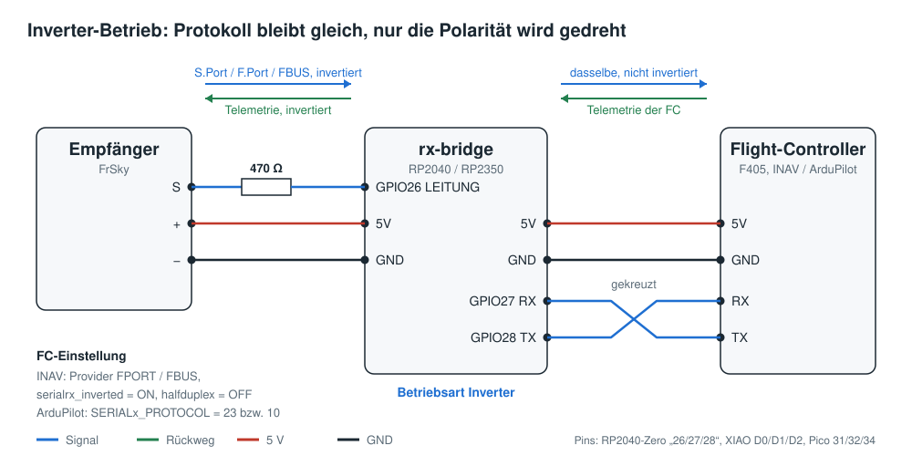
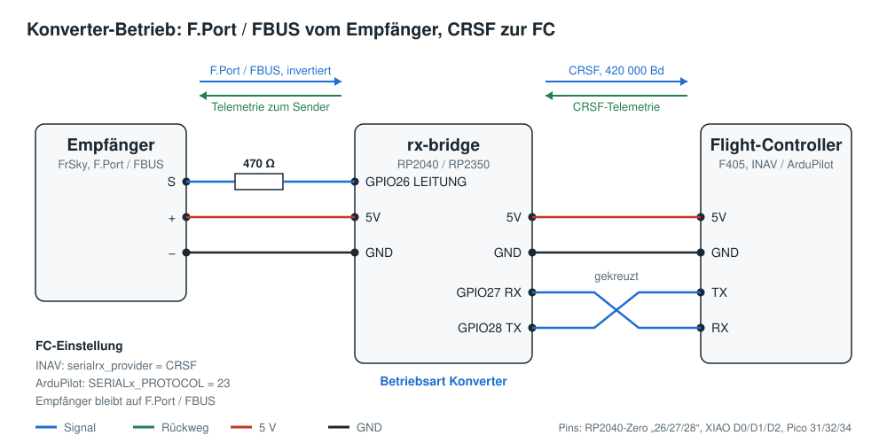

# rx-bridge – Anleitung

rx-bridge verbindet einen FrSky-Empfänger mit einem Flight-Controller, der das invertierte
FrSky-Signal nicht selbst verarbeiten kann (zum Beispiel F405-Boards mit INAV oder ArduPilot).
Es ersetzt das Inverterkabel und kann zusätzlich als Konverter arbeiten.

| Betriebsart | Wofür | Flight-Controller einstellen auf |
|---|---|---|
| **Inverter** | wie das bisherige Inverterkabel, auch für die schnellen Protokolle | S.Port, F.Port oder FBUS |
| **Konverter** | der Empfänger sendet F.Port oder FBUS, der Flight-Controller bekommt CRSF | CRSF |

Im Zweifel mit dem **Inverter** anfangen: Am Flight-Controller ändert sich dann gegenüber dem
Inverterkabel nichts.

## Was ihr braucht

- Ein RP2040- oder RP2350-Modul: Waveshare RP2040-Zero, Seeed XIAO RP2040, Raspberry Pi Pico
  oder die RP2350-Varianten davon
- einen Widerstand 470 Ω
- ein USB-Kabel und einen Computer mit **Chrome** oder **Edge** (für die Einstellungen)

## 1. Firmware aufspielen

1. BOOT-Taste am Modul gedrückt halten und das Modul per USB an den Computer anschließen.
2. Es erscheint ein Laufwerk `RPI-RP2` (bei RP2350: `RP2350`).
3. Die passende Datei von der [Release-Seite](https://github.com/Target0815/rx-bridge/releases)
   herunterladen und auf dieses Laufwerk ziehen:

| Modul | Datei |
|---|---|
| Waveshare RP2040-Zero | `rx-bridge-0.3.2-waveshare_rp2040_zero.uf2` |
| Seeed XIAO RP2040 | `rx-bridge-0.3.2-seeed_xiao_rp2040.uf2` |
| Raspberry Pi Pico | `rx-bridge-0.3.2-pico.uf2` |
| Waveshare RP2350-Zero | `rx-bridge-0.3.2-waveshare_rp2350_zero.uf2` |
| Seeed XIAO RP2350 | `rx-bridge-0.3.2-seeed_xiao_rp2350.uf2` |
| Raspberry Pi Pico 2 | `rx-bridge-0.3.2-pico2.uf2` |

Das Modul startet danach von selbst neu. Bei einem Update bleiben die Einstellungen erhalten.

## 2. Anschließen

Die Verdrahtung ist in beiden Betriebsarten gleich. Wie bei jeder seriellen Verbindung wird
**gekreuzt**: RX des Moduls an TX des Flight-Controllers, TX des Moduls an RX.

| Modul | RP2040-/RP2350-Zero | XIAO | Pico | an |
|---|---|---|---|---|
| LEITUNG | Pin „26“ | D0 | Pin 31 | Signal des Empfängers (S.Port/F.Port/FBUS), **über 470 Ω** |
| RX | Pin „27“ | D1 | Pin 32 | **TX** des Flight-Controllers |
| TX | Pin „28“ | D2 | Pin 34 | **RX** des Flight-Controllers |
| 5V | 5V | 5V | Pin 39 | 5 V vom Flight-Controller, auch für den Empfänger |
| GND | GND | GND | GND | GND von Flight-Controller und Empfänger |

**Inverter-Betrieb**



**Konverter-Betrieb**



Nur bei RP2350-Modulen: zusätzlich einen Widerstand 4,7 kΩ von LEITUNG nach GND einlöten.

## 3. Einstellen

1. Die Datei `web/index.html` per Doppelklick in Chrome oder Edge öffnen. Internet ist nicht nötig.
   (Sie liegt im Projekt und als `rx-bridge-config.html` auf der Release-Seite.)
2. Modul per USB anschließen (ohne BOOT-Taste), auf **Verbinden** klicken und das Gerät auswählen.
3. Betriebsart wählen und **Speichern** klicken. Beim Wechsel der Betriebsart startet das Modul
   neu und die Seite verbindet sich von selbst wieder.

| Einstellung | Empfehlung |
|---|---|
| Betriebsart | Inverter oder Konverter, siehe oben |
| RC-System | FrSky |
| Empfängersignal | **Invertiert** (so senden FrSky-Empfänger) |
| Haltezeit | 10 µs lassen (nur im Inverter-Betrieb) |

Oben auf der Seite zeigt der Signalpfad, ob vom Empfänger etwas ankommt und ob der
Flight-Controller antwortet. Im Konverter-Betrieb steht dort auch die erkannte Firmware des
Flight-Controllers, zum Beispiel „INAV 9.1.0“.

## 4. Flight-Controller einstellen

### Inverter-Betrieb

Der Empfänger und der Flight-Controller bleiben so eingestellt wie mit dem Inverterkabel.

INAV (CLI):

```
set serialrx_provider = FPORT       # bzw. FBUS
set serialrx_inverted = ON
set serialrx_halfduplex = OFF
save
```

Mit SBUS und getrennter S.Port-Telemetrie über rx-bridge stattdessen
`set telemetry_inverted = ON` und `set telemetry_halfduplex = OFF`.

ArduPilot: `SERIALx_PROTOCOL = 23` (F.Port/FBUS) bzw. `10` (S.Port), `SERIALx_OPTIONS = 160`,
`RSSI_TYPE = 3`.

### Konverter-Betrieb

Der Empfänger bleibt auf **F.Port** oder **FBUS**, der Flight-Controller wird auf **CRSF** umgestellt.

INAV (CLI):

```
set serialrx_provider = CRSF
set serialrx_inverted = OFF
set serialrx_halfduplex = OFF
feature TELEMETRY
save
```

ArduPilot:

```
SERIALx_PROTOCOL = 23
RSSI_TYPE        = 3
RC_OPTIONS       = 256    # für Yaapu: zum vorhandenen Wert addieren
```

## 5. Testen

Am Boden und **ohne Propeller**:

1. Sender einschalten. Auf der Konfigurationsseite muss der Empfänger erscheinen, im Konverter
   mit etwa 110 Kanal-Frames pro Sekunde und Link-Qualität 100 %.
2. Im Configurator bzw. in Mission Planner müssen sich die Kanäle mit den Knüppeln bewegen.
3. **Failsafe prüfen:** Sender ausschalten. Der Flight-Controller muss in Failsafe gehen.
4. Im Sender **Sensoren suchen**. Die Telemetrie des Flight-Controllers erscheint.

## Telemetrie-Sensoren im Sender (Konverter)

Die meisten Sensoren erkennt der Sender mit Namen und Einheit (Spannung, Strom, Höhe, GPS,
Geschwindigkeit …). Fünf zusätzliche Sensoren zeigt er nur als Nummer an. Sie lassen sich unter
Telemetrie umbenennen:

| Nummer | Bedeutung | Einstellung |
|---|---|---|
| 0430 | Nicklage | Einheit °, eine Nachkommastelle |
| 0440 | Rolllage | Einheit °, eine Nachkommastelle |
| 0450 | Kurs über Grund (GPS) | Einheit °, eine Nachkommastelle |
| 0470 | Flugmodus (nur INAV) | als Zahl lassen, wird von INAV-Lua-Skripten ausgewertet |
| 0480 | GPS-Status | als Zahl lassen: Einer und Zehner = Satelliten, +1000 = GPS-Fix |

Bei ArduPilot laufen Flugmodus, Meldungen und weitere Werte über Yaapu (`RC_OPTIONS` 256).
Die genaue Kodierung steht in der [technischen Dokumentation](docs/TECHNIK.md#telemetrie-sensoren-im-konverter-betrieb).

## LED am Modul

| Anzeige | Bedeutung |
|---|---|
| kurzes Blinken jede Sekunde | Modul läuft, vom Empfänger kommt nichts |
| blau | Empfänger sendet |
| weißes Aufblitzen | Flight-Controller sendet Telemetrie |
| schnelles blaues Blinken | Empfänger meldet Failsafe (Konverter) |

## Wenn etwas nicht geht

| Problem | Ursache und Abhilfe |
|---|---|
| Seite kann nicht verbinden | Ein Terminalprogramm oder ein zweiter Browser-Tab ist noch mit dem Modul verbunden. Schließen und neu verbinden. |
| Seite meldet „antwortet nicht“ | Modul kurz vom USB trennen, wieder anstecken, neu verbinden. Firmware 0.3 oder neuer nötig. |
| Empfänger: kein Signal | Empfänger gebunden und eingeschaltet? Im Konverter muss der Empfänger auf F.Port oder FBUS stehen (S.Port allein geht nur im Inverter). Empfängersignal auf „Invertiert“? |
| Flight-Controller bekommt keine Kanäle | RX und TX vertauscht? Sie müssen gekreuzt sein. Protokoll am Flight-Controller passt zur Betriebsart? |
| Flight-Controller „unbekannt“ (INAV) | `feature TELEMETRY` aktivieren. |
| Keine Telemetrie im Sender | Im Sender Sensoren neu suchen. Bei INAV `feature TELEMETRY`. |

Bei einer Fehlermeldung hilft das Protokoll der Konfigurationsseite: über dem Protokoll auf
**Speichern** klicken und die Datei mitschicken.

---

Alle Details zu Protokollen, Telemetrie und Aufbau: [technische Dokumentation](docs/TECHNIK.md).
