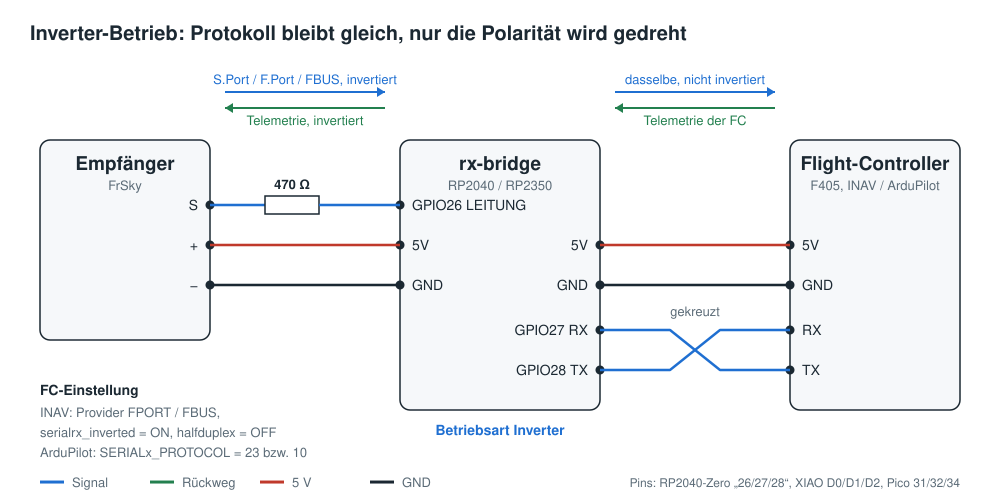
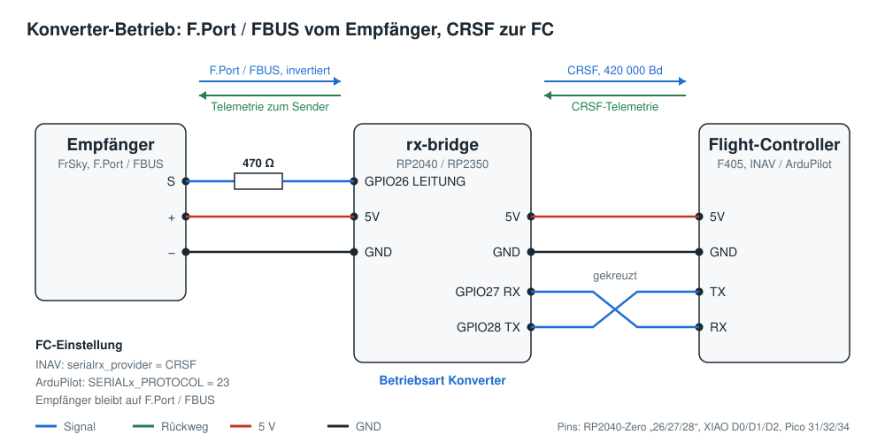
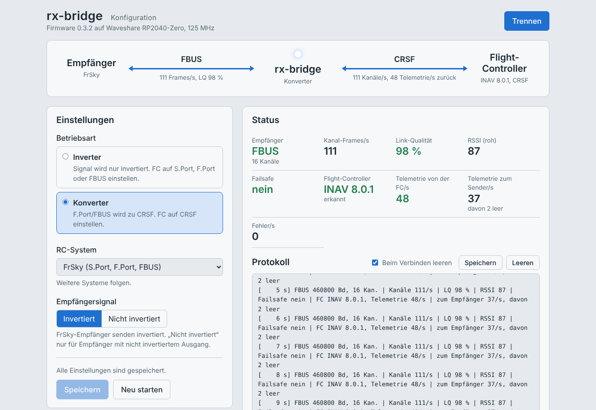

# rx-bridge 0.3.2

FrSky-Empfänger (S.Port, F.Port, FBUS) an Flight-Controllern ohne eigenen Signal-Inverter,
zum Beispiel F405-Boards mit INAV oder ArduPilot. Ein kleines RP2040- oder RP2350-Board für
wenige Euro und ein einzelner Widerstand ersetzen den Inverter. Damit funktioniert auch
**FBUS mit 460800 Baud** zuverlässig.

**Firmware herunterladen:** unter [Releases](https://github.com/Target0815/rx-bridge/releases)
die passende `.uf2`-Datei für euer Modul.

- **[Anleitung](ANLEITUNG.md)**: aufspielen, anschließen, einstellen, testen
- **[Technische Dokumentation](docs/TECHNIK.md)**: Protokolle, Telemetrie-Kodierung, Aufbau der
  Firmware, Tests, selbst bauen

## Zwei Betriebsarten

- **Inverter:** Das Board dreht das Signal in beide Richtungen um, wie ein Inverterkabel, nur
  schneller. Empfänger und Flight-Controller bleiben auf S.Port, F.Port oder FBUS.
- **Konverter:** Der Empfänger sendet F.Port oder FBUS, der Flight-Controller bekommt **CRSF**.
  Die Telemetrie des Flight-Controllers wird zurück in FrSky-Sensoren übersetzt (Akku, GPS,
  Fluglage, Flugmodus, Höhe/Vario usw.). Das Board erkennt dabei auch, ob INAV oder ArduPilot
  auf dem Flight-Controller läuft.

## Was ihr braucht

- Ein RP2040- oder RP2350-Board: Waveshare RP2040-Zero, Seeed XIAO RP2040, Raspberry Pi Pico
  oder die RP2350-Varianten davon (siehe Hinweis unten)
- Einen Widerstand 470 Ω (bei RP2350-Boards zusätzlich 4,7 kΩ von LEITUNG nach GND)
- Ein USB-Kabel und einen Computer mit Chrome oder Edge

Die Firmware wird einfach per Drag & Drop auf das Board gezogen, eine Programmierumgebung ist
nicht nötig.

> **Hinweis zu den Boards:** Getestet habe ich mit den **originalen Boards von Waveshare**,
> RP2040-Zero und RP2350-Zero. Von Nachbauten (Clones) rate ich ab. Die Firmware für
> Seeed XIAO und Raspberry Pi Pico wird mitgebaut, ist auf echter Hardware aber noch nicht
> getestet.

## Anschluss

Die Verdrahtung ist in beiden Betriebsarten gleich. RX und TX zum Flight-Controller werden
**gekreuzt** angeschlossen: RX des Moduls an TX des Flight-Controllers, TX des Moduls an RX.





## Einstellen im Browser

Die Konfiguration läuft über eine Webseite (`web/index.html`), die ihr einfach in Chrome oder
Edge öffnet. Ein Terminalprogramm oder Internet braucht ihr nicht. Dort wählt ihr die
Betriebsart und seht live, ob vom Empfänger etwas ankommt, wie gut die Verbindung ist und ob
der Flight-Controller antwortet.



*Der Screenshot zeigt die Seite mit einem simulierten Gerät, die Werte sind Beispieldaten.*

## Einstellungen am Flight-Controller

### Inverter-Betrieb

INAV:

```
set serialrx_provider = FPORT   # bzw. FBUS
set serialrx_inverted = ON
set serialrx_halfduplex = OFF
save
```

ArduPilot: `SERIALx_PROTOCOL = 23` (F.Port/FBUS) bzw. `10` (S.Port), `SERIALx_OPTIONS = 160`,
`RSSI_TYPE = 3`

### Konverter-Betrieb

INAV:

```
set serialrx_provider = CRSF
set serialrx_inverted = OFF
set serialrx_halfduplex = OFF
feature TELEMETRY
save
```

ArduPilot: `SERIALx_PROTOCOL = 23`, `RSSI_TYPE = 3`, für Yaapu zusätzlich `RC_OPTIONS = 256`
(zum vorhandenen Wert addieren)

## Stand und Tester gesucht

Beide Betriebsarten wurden auf echter Hardware mit INAV und ArduPilot getestet, mit S.Port,
F.Port und FBUS. Gesucht werden weitere Tester mit unterschiedlichen Empfängern,
Flight-Controllern und Modellen. Rückmeldungen und Fehlerberichte bitte als
[Issue](https://github.com/Target0815/rx-bridge/issues), am besten mit dem gespeicherten
Protokoll der Konfigurationsseite.

## Inhalt des Repositorys

| Ordner | Inhalt |
|---|---|
| `web/` | Konfigurationsseite, in Chrome oder Edge öffnen |
| `docs/` | technische Dokumentation und Schaltbilder |
| `src/` | Quellcode der Firmware |
| `test/` | automatische Tests |

## Lizenz

GNU General Public License v3.0, siehe [LICENSE](LICENSE).
