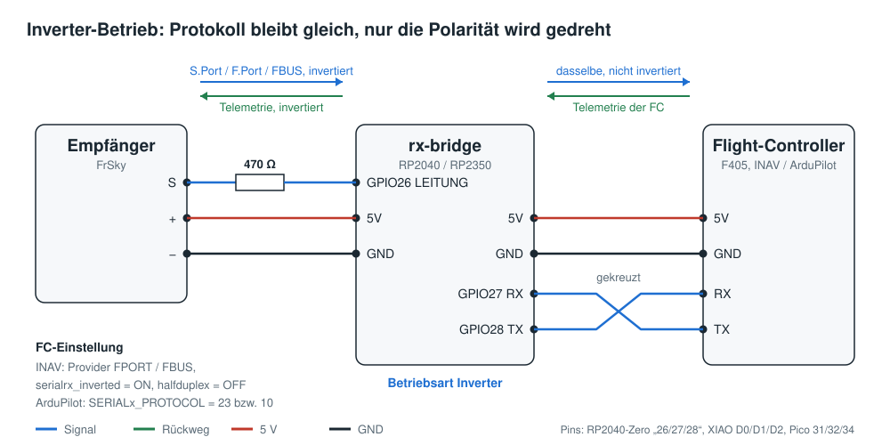
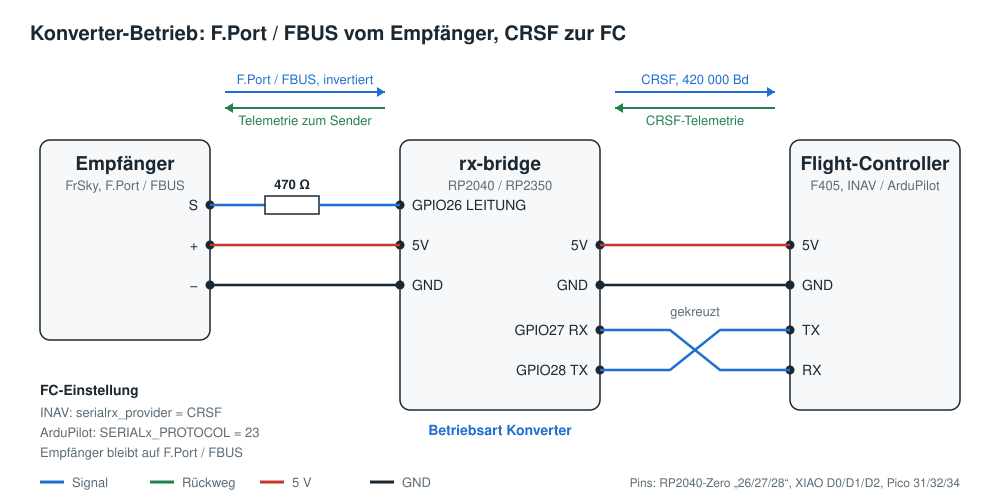

# rx-bridge 0.3.2 – technische Dokumentation

Vollständige Beschreibung mit allen Details zu Protokollen, Telemetrie, Aufbau der Firmware
und Tests. Für den reinen Einsatz genügt die [Anleitung](../ANLEITUNG.md).

Firmware für ein fertiges RP2040- oder RP2350-Modul zwischen FrSky-Empfänger und
Flight-Controller (INAV, ArduPilot). Zwei Betriebsarten:

| Betriebsart | Was passiert | FC eingestellt auf |
|---|---|---|
| **Inverter** (Standard) | bidirektionaler Inverter, ersetzt das Inverterkabel | S.Port, F.Port oder FBUS wie bisher |
| **Konverter** | F.Port / FBUS wird dekodiert und als **CRSF** an die FC gegeben, Telemetrie der FC geht als FrSky-Sensoren zurück zum Empfänger | CRSF |

Beide Betriebsarten sind mit INAV und ArduPilot auf echter Hardware getestet. Eingestellt
wird alles über eine Konfigurationsseite im Browser, ein Terminalprogramm ist nicht mehr nötig.

**Neu in 0.3.2:** Protokolle überall in der Reihenfolge S.Port, F.Port, FBUS; Einstellung heißt
„Empfängersignal: invertiert / nicht invertiert“; die erste Statuszeile nach dem Verbinden zeigt
jetzt die Werte einer Sekunde (vorher alles seit dem letzten Verbinden). Doku aufgeteilt in
Anleitung und technische Dokumentation.

**Neu in 0.3.1:** „Neu starten“ und der Wechsel der Betriebsart funktionieren jetzt auch im
Konverter-Betrieb (in 0.3.0 blieb das Modul dort hängen). Der Konverter erkennt die Firmware
der FC (INAV oder ArduPilot mit Version). Auf der Seite lässt sich das Protokoll beim
Verbinden automatisch leeren.

**Neu in 0.3.0:** Konfigurationsseite (`web/index.html` im Projektordner), Einstellung RC-System,
Schaltbilder, Erklärung aller Telemetrie-Sensoren.

## Boards und Flashen

| Datei (Release-Seite bzw. nach `./build_all.sh` in `dist/`) | Board |
|---|---|
| `rx-bridge-0.3.2-waveshare_rp2040_zero.uf2` | Waveshare RP2040-Zero |
| `rx-bridge-0.3.2-seeed_xiao_rp2040.uf2` | Seeed XIAO RP2040 |
| `rx-bridge-0.3.2-pico.uf2` | Raspberry Pi Pico |
| `rx-bridge-0.3.2-waveshare_rp2350_zero.uf2` | Waveshare RP2350-Zero |
| `rx-bridge-0.3.2-seeed_xiao_rp2350.uf2` | Seeed XIAO RP2350 |
| `rx-bridge-0.3.2-pico2.uf2` | Raspberry Pi Pico 2 |

1. BOOT-Taste gedrückt halten und das Board per USB anstecken.
2. Auf das Laufwerk `RPI-RP2` bzw. `RP2350` die passende `.uf2` ziehen.
3. Das Board startet neu. Einstellungen aus älteren Versionen bleiben erhalten.

## Konfigurationsseite

`web/index.html` in **Chrome oder Edge** auf dem Computer öffnen (Doppelklick auf die Datei
genügt, eine Internetverbindung ist nicht nötig). Firefox und Safari können nicht auf
USB-Geräte zugreifen.

1. Modul per USB anstecken, auf **Verbinden** klicken und im Fenster das Gerät auswählen
   („Pico“ bzw. „RP2350“).
2. Oben zeigt der Signalpfad live, was zwischen Empfänger, rx-bridge und FC läuft. Die LED in
   der Mitte verhält sich wie die LED auf dem Modul.
3. Einstellungen ändern und **Speichern**. Bei einem Wechsel der Betriebsart heißt der Knopf
   **Speichern und neu starten**; das Modul startet neu und die Seite verbindet sich
   automatisch wieder.
4. Rechts stehen die aktuellen Werte und das Protokoll. Mit **Speichern** über dem Protokoll
   lässt es sich als Textdatei sichern, zum Beispiel für eine Fehlermeldung. Ist „Beim
   Verbinden leeren“ angehakt (Standard), beginnt jede neue Verbindung mit einem leeren
   Protokoll; die Wahl merkt sich der Browser.

Die Statuswerte im Konverter-Betrieb:

| Anzeige | Bedeutung |
|---|---|
| Empfänger | erkanntes Protokoll und Kanalzahl |
| Kanal-Frames/s | an die FC weitergegebene Kanal-Frames pro Sekunde (FBUS: etwa 110) |
| Link-Qualität, RSSI | siehe [Was der Konverter macht](#was-der-konverter-macht) |
| Flight-Controller | erkannte FC-Firmware, siehe [FC-Erkennung](#fc-erkennung) |
| Telemetrie von der FC/s | CRSF-Telemetrie-Frames, die von der FC kommen |
| Telemetrie zum Sender/s | Antworten auf die Telemetrie-Abfragen des Empfängers. „Davon leer“ sind Antworten ohne Messwert: entweder hatte der Empfänger nur nachgefragt, ob die FC noch da ist (Null-Abfrage), oder es lag gerade kein frischer Wert vor. Ein paar leere Antworten sind normal. |
| Fehler/s | Prüfsummenfehler, verspätete Antworten, verworfene Passthrough-Daten |

| Einstellung | Bedeutung |
|---|---|
| Betriebsart | Inverter oder Konverter |
| RC-System | derzeit nur FrSky (S.Port, F.Port, FBUS) |
| Empfängersignal | invertiert (FrSky, Standard) oder nicht invertiert für Empfänger mit nicht invertiertem Ausgang |
| Haltezeit | nur Inverter: wie lange die Leitung nach einem FC-Telegramm aktiv gehalten wird, Standard 10 µs |

Ein Terminalprogramm funktioniert weiterhin, siehe [Terminal](#terminal-alternative).
Terminal und Konfigurationsseite können nicht gleichzeitig verbunden sein.

## Verdrahtung

Das Modul wird wie jedes UART-Gerät **gekreuzt** angeschlossen: RX an TX, TX an RX.
RX und TX beziehen sich auf das Modul. Die Verdrahtung ist in beiden Betriebsarten gleich;
die Schaltbilder zeigen, was jeweils über die Leitungen läuft und wie die FC eingestellt wird.

### Inverter-Betrieb



### Konverter-Betrieb



| Modul | GPIO | RP2040-/RP2350-Zero | XIAO | Pico / Pico 2 | an |
|---|---|---|---|---|---|
| LEITUNG | 26 | Pin „26“ | D0 | Pin 31 | S.Port/F.Port/FBUS des Empfängers, **über 470 Ω** |
| RX | 27 | Pin „27“ | D1 | Pin 32 | **TX** der FC |
| TX | 28 | Pin „28“ | D2 | Pin 34 | **RX** der FC |
| 5V | – | 5V | 5V | VSYS (Pin 39) | 5 V der FC, versorgt auch den Empfänger |
| GND | – | GND | GND | GND | GND von FC und Empfänger |

- Der 470-Ω-Widerstand ist das einzige Zusatzbauteil: Er begrenzt den Strom, falls beide
  Seiten gleichzeitig senden, und schützt den 3,3-V-Eingang (RP2040 ist nicht 5-V-tolerant).
- **Nur RP2350-Boards:** Frühe RP2350 (Stepping A2) haben ein Erratum (E9), durch das der
  interne Pull-down nicht zuverlässig wirkt. Dort zusätzlich 4,7 kΩ von LEITUNG nach GND.

## FC-Konfiguration – Inverter

INAV, getestet mit SBUS+S.Port, F.Port und FBUS:

```
set serialrx_provider = FPORT       # bzw. FBUS
set serialrx_inverted = ON
set serialrx_halfduplex = OFF
save
```

S.Port-Telemetrie (Empfänger per SBUS, Telemetrie über rx-bridge):
`telemetry_inverted = ON`, `telemetry_halfduplex = OFF`.

ArduPilot: F.Port/FBUS `SERIALx_PROTOCOL = 23`, `SERIALx_OPTIONS = 160`, `RSSI_TYPE = 3`;
S.Port-Passthrough `SERIALx_PROTOCOL = 10`, `SERIALx_OPTIONS = 160`.

## FC-Konfiguration – Konverter

Der Empfänger bleibt auf **F.Port** oder **FBUS** eingestellt, die FC wird auf **CRSF** umgestellt.

**INAV:** im Configurator den UART auf „Serial RX“, dann

```
set serialrx_provider = CRSF
set serialrx_inverted = OFF
set serialrx_halfduplex = OFF
feature TELEMETRY
save
```

INAV sendet dann von sich aus CRSF-Telemetrie (Akku, GPS, Fluglage, Flugmodus, Höhe/Vario,
Airspeed mit Pitot-Rohr).

**ArduPilot (Plane):**

```
SERIALx_PROTOCOL = 23      # RCIN
RSSI_TYPE        = 3
RC_OPTIONS       = 256     # optional: Passthrough-Telemetrie für Yaapu, zum vorhandenen Wert addieren
```

ArduPilot erkennt CRSF automatisch (sucht mit 416 666 Baud, rx-bridge sendet mit
420 000 Baud; die 0,8 % Abweichung sind unkritisch). rx-bridge beantwortet die Geräteabfrage
von ArduPilot, die Meldung „RX device ping failed“ kommt deshalb nicht.

SBUS+S.Port gibt es nur im Inverter-Betrieb (der Konverter braucht das kombinierte
Protokoll auf einer Leitung).

## Was der Konverter macht

**Steuerkanäle:** Jeder F.Port/FBUS-Frame wird sofort als CRSF-Frame weitergegeben
(16 Kanäle, Werte 1:1, gleiche Auflösung). Dazu kommen einige Mikrosekunden Rechenzeit
und die Übertragung des CRSF-Frames (0,6 ms). Bei FBUS mit 24 Kanälen gehen nur die ersten
16 durch.

**Failsafe:** Meldet der Empfänger Failsafe, werden keine Kanal-Frames mehr gesendet.
Die FC erkennt den Signalverlust dann selbst und löst ihr eigenes Failsafe aus, so wie bei
einem CRSF/ELRS-Empfänger. Kommt vom Empfänger nichts mehr, meldet rx-bridge der FC
zusätzlich zweimal pro Sekunde LQ 0.

**Link-Qualität:** rx-bridge erzeugt CRSF-Link-Statistiken (10 pro Sekunde):

- **LQ** = Anteil der Frames, die in den letzten 100 Rahmen angekommen sind (Frames mit
  Lost-Flag zählen als verloren).
- **RSSI** wird aus dem RSSI-Wert des Empfängers grob umgerechnet (100 → −30 dBm,
  0 → −120 dBm). Wie FrSky den Wert skaliert, ist nicht dokumentiert; den Rohwert zeigt die
  Konfigurationsseite an.

Die Link-Statistik liegt zeitlich zwischen zwei Kanal-Frames, weil INAV nur einen
CRSF-Empfangspuffer hat und ein direkt folgender Frame den Kanal-Frame überschreiben würde.

### FC-Erkennung

Im Konverter-Betrieb fragt rx-bridge die Firmware der FC ab und zeigt sie auf der
Konfigurationsseite an, zum Beispiel „INAV 8.0.1“ oder „ArduPlane V4.5.7 (…)“.

- **ArduPilot** beantwortet die CRSF-Geräteabfrage mit Namen und Version.
- **INAV** beantwortet diese Abfrage nicht, liefert Variante und Version aber über MSP über
  CRSF, so wie es auch das INAV-Lua-Skript im Sender nutzt. Dafür muss in INAV
  `feature TELEMETRY` aktiv sein.

Die Abfragen laufen einmal pro Sekunde, bis die FC erkannt ist (höchstens 30 Versuche), und
belegen jeweils den Platz einer Link-Statistik zwischen zwei Kanal-Frames. Schweigt die FC
länger als 5 s, wird die Erkennung wiederholt. Im Inverter-Betrieb ist keine Erkennung möglich,
weil rx-bridge dort nur das Signal durchreicht.

**Empfängerprotokoll** wird automatisch erkannt: F.Port 1 und F.Port 2 (115 200) sowie
FBUS (460 800). Solange nichts erkannt ist, wechselt rx-bridge alle 0,3 s zwischen den Baudraten.

## Telemetrie-Sensoren im Konverter-Betrieb

rx-bridge antwortet auf die Abfragen des Empfängers für die FC (Physical ID 0x1B) 0,5 ms nach
der Abfrage. Die Werte kommen aus der CRSF-Telemetrie der FC. Sensor-IDs und Einheiten sind
dieselben wie bei der SmartPort-Telemetrie von INAV, damit auch die INAV-Lua-Skripte sie
verstehen. Werte, die älter als 5 s sind, werden nicht mehr gesendet.

### FrSky-Standardsensoren

Diese erkennen EdgeTX und ETHOS mit Namen und Einheit:

| ID | Name im Sender | Inhalt | Quelle |
|---|---|---|---|
| 0210 | VFAS | Akkuspannung | Akku |
| 0200 | Curr | Strom | Akku |
| 0600 | Fuel | Restkapazität in % | Akku |
| 0100 | Alt | Höhe über Startpunkt | Baro |
| 0110 | VSpd | Steig-/Sinkrate | Vario |
| 0800 | GPS | Position | GPS |
| 0820 | GAlt | GPS-Höhe | GPS |
| 0830 | GSpd | Geschwindigkeit über Grund | GPS |
| 0840 | Hdg | Steuerkurs (Nase) | Fluglage |
| 0A00 | ASpd | Fahrt | Airspeed |

### Zusätzliche INAV-Sensoren

Diese Kennungen gehören nicht zum FrSky-Standard. Der Sender zeigt sie zunächst nur als
Nummer ohne Einheit an. Unter Telemetrie lassen sie sich umbenennen und mit Einheit versehen:

| ID | Vorschlag Name | Inhalt | Rohwert | Einstellung im Sender |
|---|---|---|---|---|
| 0430 | Ptch | Nicklage | Zehntelgrad, z. B. 125 = 12,5° | Einheit °, 1 Nachkommastelle |
| 0440 | Roll | Rolllage | Zehntelgrad, negativ = links | Einheit °, 1 Nachkommastelle |
| 0450 | Krs | Kurs über Grund (GPS) | Zehntelgrad, 0–3599 | Einheit °, 1 Nachkommastelle |
| 0470 | Mode | Flugmodus und Arming-Status | ziffernkodiert, siehe unten | ohne Einheit |
| 0480 | GNSS | GPS-Status | Satelliten + Fix, siehe unten | ohne Einheit |

Bei ArduPilot erzeugt rx-bridge 0430, 0440, 0450 und 0480 ebenfalls aus den CRSF-Daten.
0470 gibt es nur mit INAV: Der Wert wird aus dem Flugmodus-Text gebildet, und die Modusnamen
von ArduPilot (FBWA, CRUS, LOIT …) passen nicht in dieses Schema. Bei ArduPilot kommen
Flugmodus und Arming-Status über die Passthrough-Daten (siehe unten).

**0470 Flugmodus**, jede Dezimalstelle steht für eine Gruppe:

| Stelle | Werte |
|---|---|
| Einer | 1 = bereit zum Scharfschalten, 2 = Scharfschalten gesperrt, +4 = scharf |
| Zehner | 1 = ANGLE, 2 = HORIZON, 4 = MANUAL |
| Hunderter | 1 = Heading Hold, 2 = Höhe halten, 4 = Position halten (Multikopter) |
| Tausender | 1 = RTH, 2 = Wegpunkte, 4 = Headfree, 8 = Kurs halten |
| Zehntausender | 1 = Flaperon, 2 = Autotune, 4 = Failsafe |
| Hunderttausender | 1 = Autolandung, 2 = Turtle, 4 = Geozone, 8 = Loiter (Fläche) |
| Millionen | 1 = RTH der Wegpunktmission, 2 = Anglehold |

Beispiele: 1 = nicht scharf, bereit; 15 = scharf in ANGLE; 1005 = scharf in RTH;
8205 = scharf in Cruise (Kurs und Höhe halten). Die Tabelle zeigt die INAV-Kodierung;
rx-bridge kann nur setzen, was sich aus dem Flugmodus-Text ableiten lässt (zum Beispiel nicht
Flaperon oder Heading Hold).

**0480 GPS-Status:** Einer und Zehner sind die Satellitenzahl, +1000 bedeutet GPS-Fix.
Beispiel: 1014 = Fix mit 14 Satelliten. CRSF überträgt keine Fix-Art, deshalb setzt
rx-bridge den Fix ab 4 Satelliten mit gültigen Koordinaten. HDOP (Hunderterstelle) und
„Home gesetzt“ (+2000) gibt es in CRSF nicht, sie bleiben 0.

### ArduPilot-Passthrough

Mit `RC_OPTIONS` Bit 8 (+256) schickt ArduPilot zusätzlich FrSky-Passthrough-Daten
(Kennungen 0x5000–0x50FF) über CRSF. rx-bridge reicht sie unverändert an den Empfänger weiter
und wandelt Statusmeldungen in das 0x5000-Format um. Damit funktionieren Yaapu und die
Meldungsanzeige wie mit einem FrSky-Empfänger direkt an der FC.

## Status-LED

| Anzeige | Bedeutung |
|---|---|
| kurzes Blinken jede Sekunde | läuft, kein Empfängersignal |
| blau | Empfänger sendet (Konverter: Kanäle werden weitergegeben) |
| weißes Aufblitzen | FC sendet (Telemetrie) |
| schnelles blaues Blinken | Empfänger meldet Failsafe (nur Konverter) |

## Terminal (Alternative)

Jedes Terminalprogramm geht weiterhin (Baudrate egal). Jede Sekunde kommt eine Statuszeile,
gesteuert wird mit einzelnen Tasten:

| Taste | Funktion |
|---|---|
| `?` | Hilfe und Einstellungen |
| `m` | Betriebsart wechseln (speichert und startet neu) |
| `i` | Empfängersignal umschalten (invertiert / nicht invertiert) |
| `h` | Haltezeit wechseln (nur Inverter) |
| `s` | Einstellungen speichern (im Konverter kurze Signalpause zur FC, nur am Boden) |
| `q` | Statuszeilen ein/aus |
| `b` | USB-Bootloader für ein Update |

Die Konfigurationsseite nutzt dieselbe Schnittstelle mit Befehlszeilen, die mit `#` beginnen
(`#hello`, `#get`, `#set mode=1`, `#save`, `#reboot`, `#json 1`). Das Protokoll ist in
`src/webcmd.h` beschrieben.

## Wie es funktioniert

**Inverter:** vier PIO-Zustandsmaschinen setzen das Signal bitweise um (Latenz 24 ns), die CPU
ist am Signalweg nicht beteiligt.

**Konverter:** PIO-UARTs für beide Seiten: halbduplex auf der Empfängerleitung (die Leitung
wird nur während des eigenen Sendens getrieben und 0,2 Bit nach dem letzten Stoppbit
freigegeben), vollduplex zur FC. Der Protokollkern (`src/proto/`) läuft allein auf Core 1;
Core 0 macht nur USB, LED und die Konfiguration. Ein Watchdog (300 ms) startet das Modul neu,
falls der Protokollkern hängt.

## Prüfstatus

- Inverter und Konverter auf echter Hardware mit INAV und ArduPilot getestet.
- `test/run_tests.sh` führt alle automatischen Tests aus:
  - **Gegenprobe mit dem Original-Code von INAV** (`test/inav/`, braucht einen
    INAV-Checkout): CRSF-, F.Port- und FBUS-Frames durch die echten INAV-Parser,
    Telemetrie-Antworten Byte für Byte identisch mit INAV. Die FC-Erkennung läuft gegen
    INAVs MSP-Verarbeitung (`telemetry/msp_shared.c`); INAV bekommt dabei alle Kanal-Frames.
  - **Protokollkern und Zeitsimulation** (`test/host/`): 30 s F.Port und FBUS mit
    Frameverlust, Failsafe und abgeschaltetem Empfänger; Telemetrie-Umrechnung,
    ArduPilot-Passthrough; Befehlsprotokoll der Konfigurationsseite.
  - **PIO-Programme** (`test/pio_sim.py`): taktgenaue Simulation der UARTs.
  - **Konfigurationsseite** (`test/web/`): läuft in Chromium gegen ein simuliertes Modul
    (Verbinden, Umschalten, Speichern mit Neustart und Wiederverbinden, Neustart bleibt aus,
    Failsafe-Anzeige, FC-Name, Protokoll leeren, alte Firmware, Browser ohne WebSerial,
    Handy-Breite). Die Seite bekommt dabei auch die
    echten JSON-Zeilen aus dem Firmware-Code.
- Die Firmware baut für alle sechs Boards ohne Compiler-Warnungen.

## Selbst bauen

[Pico SDK](https://github.com/raspberrypi/pico-sdk) 2.x, CMake, Ninja, `arm-none-eabi-gcc`:

```
export PICO_SDK_PATH=/pfad/zum/pico-sdk
./build_all.sh                                   # alle Boards nach dist/
cmake -G Ninja -B build -DPICO_BOARD=waveshare_rp2040_zero && ninja -C build
```

Andere Pins: `-DPIN_LINE=… -DPIN_RX=… -DPIN_TX=…`.
Schaltbilder neu erzeugen: `python3 docs/make_diagrams.py`.

Tests:

```
cmake -G Ninja -B build/pico -DPICO_BOARD=pico && ninja -C build/pico
git clone --depth 1 https://github.com/iNavFlight/inav /tmp/inav   # optional
test/run_tests.sh /tmp/inav
```

Für den Browsertest werden Node.js und Playwright mit Chromium gebraucht; fehlen sie, wird
der Test übersprungen.
